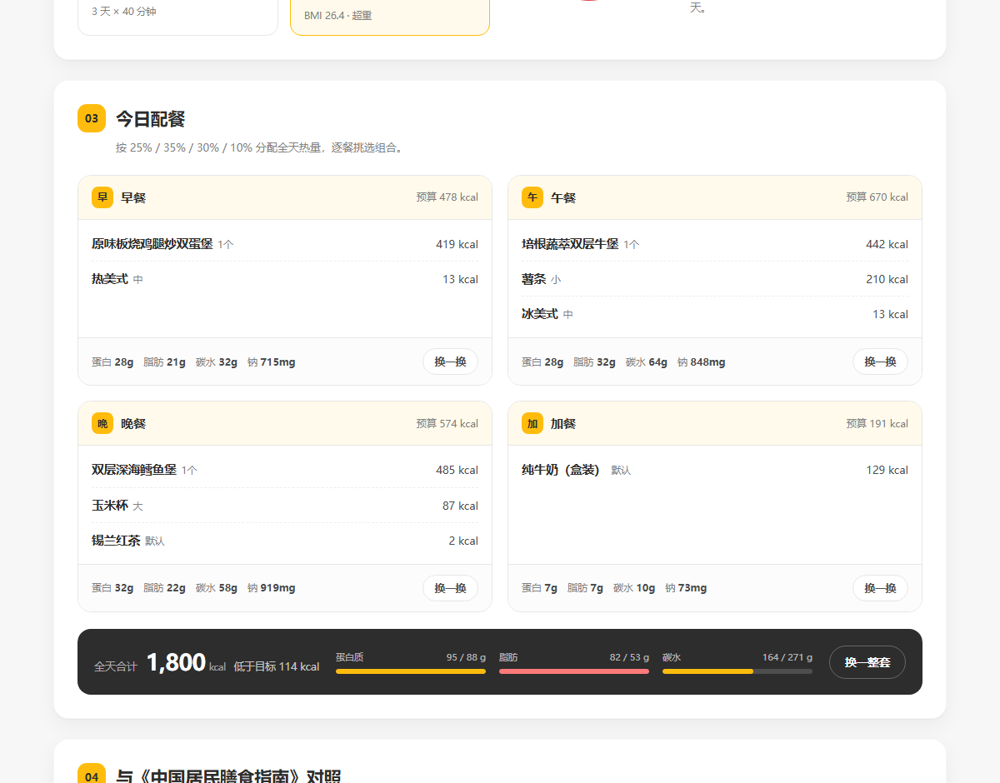
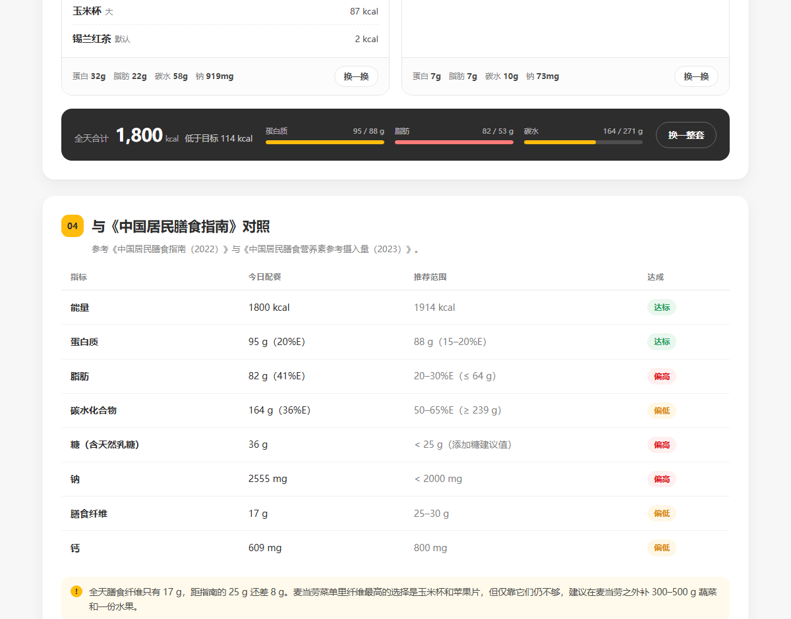

# 麦搭 · MCD Fit Planner

**在麦当劳减脂，第一步不是「能不能吃」，而是「今天能吃多少、具体点什么」。**

麦搭是一个基于麦当劳 MCP 的 **WorkBuddy Skill**：在对话里说一句「我 172/78，想在 12 周减到 70，今天三顿都在麦当劳」，它会调 MCP 取官方营养数据、按你的身体算出今天的热量上限、从 132 个真实 SKU 里配出早/午/晚/加餐，最后给出一张**可交互的网页配餐单**（也能直接回一份 Markdown 清单）。

网页是它的**输出物**，不是它的全部——计算、取数、决策都在 Skill 里。

> 本项目为「麦当劳程序员节创意开发大赛」参赛作品，由参赛者独立开发，**非麦当劳官方产品**。

打开网页先弹一张卡片，填完自动收起、直接出结果；之后点「修改档案」随时再开：


---

## 它解决什么问题

减脂期的真实场景不是「今天该不该吃麦当劳」，而是**加班到九点、只有麦当劳还开着，这一顿到底怎么点**。

市面上的热量计算器只回答「这个汉堡多少卡」，不回答「那我一整天怎么排」。麦搭把三件事接了起来：

1. **你的能耗**——不是查表，是按你的身高体重年龄和运动量算出来的；
2. **你还能吃多少**——按目标体重和周期反推缺口，并卡死安全下限；
3. **具体点什么**——从 132 个真实 SKU 里搜出四个餐次的组合，同时兼顾蛋白质、脂肪、钠和膳食纤维。

## 作为 Skill 怎么用

### 方式一：在 WorkBuddy 里用（推荐）

1. 按 [MCP_INTEGRATION.md](MCP_INTEGRATION.md) 配好 `mcd-mcp` 连接器（配置模板见 [`mcp-config.example.json`](mcp-config.example.json)）
2. 把本仓库的 `SKILL.md` 所在目录放到 `~/.workbuddy/skills/mcd-fit-planner/`
3. 直接说：*"帮我用麦当劳配一天的减脂餐，男 28 岁 172cm 78kg，目标 70kg，每周慢跑 3 次各 40 分钟"*

Skill 会依次完成：MCP 取数 → BMR/TDEE → 四餐组合搜索 → 指南对照 → 输出清单（并可选导出网页）。

### 方式二：命令行

```bash
# 只用内置快照，直接出配餐清单
python scripts/run_planner.py --sex male --age 28 --height 172 --weight 78 --target 70

# 走 MCP 实时数据 + 查附近门店 + 导出可交互网页
export MCD_MCP_TOKEN=<your_token>
python scripts/run_planner.py --sex male --age 28 --height 172 --weight 78 --target 70 \
    --stores "上海市徐汇区漕溪北路" --html
```

`--html` 会在仓库根目录生成 `plan-<时间戳>.html`，打开就是一份填好你数据的配餐单，页头会标注「数据源：麦当劳 MCP 实时查询」。

### 方式三：纯网页

不需要任何环境，双击 `index.html` 就能用。第一次打开会弹出「身体档案」卡片——性别、年龄、身高、体重、目标、周期、活动量、运动量一次填完，页脚实时显示算出来的每日目标热量和预计速度，点「生成配餐」收起弹框看结果。默认值就是一份可用的示例，直接点也成立。

之后的修改入口是档案卡上的「修改档案」按钮，Esc 或点遮罩也能关。

## 核心能力

| 能力 | 说明 |
| --- | --- |
| 能量测算 | Mifflin-St Jeor 算 BMR，PAL 折算日常活动，MET 折算运动消耗，三者相加得 TDEE |
| 缺口控制 | 按目标体重与周期反推缺口，自动被「≤ TDEE 20%」「≥ BMR × 1.1」两条安全线夹住 |
| 智能配餐 | 逐餐束搜索（beam search），132 个 SKU → 四餐组合，按全天代价函数取最优 |
| 指南对照 | 能量、蛋白质、脂肪、碳水、糖、钠、膳食纤维、钙 8 项逐条比对，并给出可执行的置换动作 |
| 偏好过滤 | 不吃牛肉 / 不吃辣 / 不吃鱼 / 尽量低钠 / 高蛋白优先 |
| 门店直达 | 一键跳转麦当劳官方门店地图；接入 MCP 后直接列出附近门店、距离和营业时间 |

## 快速开始

不需要安装任何依赖（纯标准库），也不需要后端：

```bash
git clone <本仓库地址>
cd mcd-fit-planner

# 网页
open index.html          # Windows 直接双击即可

# Skill 命令行
python scripts/run_planner.py --sex male --age 28 --height 172 --weight 78 --target 70
```

网页里输入框改任何一项，结果都会实时重算。

## 计算模型

### 1. 能量消耗

```
BMR(男) = 10×体重 + 6.25×身高 − 5×年龄 + 5
BMR(女) = 10×体重 + 6.25×身高 − 5×年龄 − 161        ← Mifflin-St Jeor
日常活动 = BMR × PAL                                  ← PAL 1.20 / 1.30 / 1.40 / 1.50 / 1.65
运动消耗 = MET × 体重(kg) × 时长(h) × 每周天数 ÷ 7     ← 日均摊分
TDEE     = 日常活动 + 运动消耗
```

PAL 取自《中国居民膳食指南（2022）》的体力活动水平分级；MET 采用运动能量消耗通用值（快走 4.3、慢跑 7.0、跑步 9.8、骑行 6.8、游泳 6.0、力量训练 5.0、HIIT 8.5、瑜伽 2.5）。

### 2. 热量缺口

```
所需缺口 = (当前体重 − 目标体重) × 7700 ÷ (周期周数 × 7)
实际缺口 = min(所需缺口, TDEE × 20%, 750)
摄入下限 = max(BMR × 1.1, 男 1500 / 女 1200)
```

7700 kcal ≈ 1 kg 脂肪。缺口被上限夹住时，页面会明确告诉用户「实际达成会比设定的慢」。

### 3. 宏量分配

| 营养素 | 取值 | 依据 |
| --- | --- | --- |
| 蛋白质 | 1.25 g/kg 目标体重（下限 1.2 / 上限 1.6） | 减脂期保肌，控制在 15–25%E |
| 脂肪 | 25%E（下限 0.6 g/kg） | 指南 AMDR 20–30% 的中值 |
| 碳水 | 剩余热量 | 低于 50%E 时自动压脂肪补碳水 |

### 4. 配餐搜索

四餐热量按 **25% / 35% / 30% / 10%** 分配。每餐先枚举候选组合：

- 早餐：13 款麦满分/粥/卷 × 6 款饮品
- 午/晚餐：13 款汉堡 × 9 款小食 × 7 款饮品
- 加餐：10 款小食/甜品/乳品

再对组合做全天级评价（beam width 160）：

```
代价 = 热量偏差×900 + 蛋白不足×430 + 脂肪超 30%E×650 + 碳水低于 50%E×620
     + 钠超 2000mg×220 + 糖超 30g×140 + 纤维不足×70 + 钙不足×40
     + 全天重复单品罚分
```

排序后从最优的 5 天里按权重随机取一条，所以「换一整套」会给出明显不同的方案，但都保持在约束内。



## 与膳食指南的对照

参考《中国居民膳食指南（2022）》与《中国居民膳食营养素参考摄入量（2023）》：

| 指标 | 推荐值 |
| --- | --- |
| 蛋白质 | 15–20%E |
| 脂肪 | 20–30%E |
| 碳水 | 50–65%E |
| 添加糖 | < 25 g/d |
| 钠 | < 2000 mg/d（食盐 < 5 g） |
| 膳食纤维 | 25–30 g/d |
| 钙 | 800 mg/d |



**这里有一个不打算回避的结论：** 纯麦当劳的一天做不到指南的脂肪比例。

以示例档案为例（TDEE 2392、目标 1914 kcal），把「四餐 = 早餐+加餐+两顿正餐」的组合空间**穷举一遍**，在满足「全天 1700–1900 kcal、蛋白质 ≥ 85 g」的前提下，脂肪的理论最低值是 **81 g**（对应 1852 kcal，39%E）。麦搭给出的方案是 82 g / 1800 kcal——绝对值只差 1 g，已经贴着可行域的下边界；比例上显得更高，是因为当天的总热量更低。

所以那三行「偏高」不是算法没优化好，是菜单结构：碳水几乎全部来自汉堡面包，蛋白质密度高的单品普遍带脂肪。工具把这一项标成「偏高」，并给出三条可执行的置换：油炸小食换玉米杯/苹果片、安格斯换板烧或麦香鱼、含酱汉堡换吉士汉堡包。

诚实标注比粉饰更有用：用户需要知道的是**差在哪、怎么补**，而不是一个好看的全绿表格。

## 数据来源

- **餐品营养**：麦当劳中国官网营养计算器 <https://www.mcdonalds.com.cn/nutrition_calculator>，页面内嵌数据，官方标注更新于 **2025 年 4 月**，共 132 个 SKU，字段含能量、蛋白质、脂肪、碳水、钠、钙、饱和脂肪、胆固醇、糖、膳食纤维。
- **门店地图**：<https://www.mcdonalds.com.cn/top/map>
- **营养目标**：《中国居民膳食指南（2022）》《中国居民膳食营养素参考摄入量（2023）》

数据抓取与清洗脚本见 `data/`，原始页面结构备份在 `data/raw_nutrition.json`。

## 麦当劳 MCP 集成

Skill 通过 WorkBuddy 连接器（或内置的 `scripts/mcp_client.py`）接入麦当劳中国 MCP Server（`https://mcp.mcd.cn`，Streamable HTTP，Bearer Token）：

| Tool | 在麦搭里的作用 | 实测 |
| --- | --- | --- |
| `list-nutrition-foods` | 取官方营养数据，覆盖内置快照 | 返回 158 条，与本地 132 个 SKU **全部匹配**（详见集成文档） |
| `query-nearby-stores` | 按城市 + 关键词返回附近门店、距离、营业时间 | 已跑通，结果直接渲染进「找餐厅」卡片 |
| `query-meals` / `calculate-price` | 校验可售、补预估价格（增强） | 已确认在工具列表中，参数见集成文档 |

**MCP 不可用时自动降级到内置快照**，并在输出里注明数据来源，不会假装是实时数据。

配置模板见 [`mcp-config.example.json`](mcp-config.example.json)（Token 用环境变量占位，仓库内不含任何凭证）；完整调用流程见 [MCP_INTEGRATION.md](MCP_INTEGRATION.md)。

## 目录结构

```
mcd-fit-planner/
├── SKILL.md                      # WorkBuddy Skill 定义（对话入口）
├── index.html                    # 配餐页主体（Skill 的输出物，也可独立使用）
├── assets/
│   ├── style.css                 # 麦当劳官网配色 #FFBC0D / #DB0007 / #2D2D2D
│   └── app.js                    # 能量计算 + 配餐搜索 + 渲染 + 预置方案注入
├── data/
│   ├── nutrition_mcd_cn.json     # 132 个 SKU 的完整营养字段
│   ├── nutrition.js              # 同一份数据的浏览器版本
│   └── raw_nutrition.json        # 官网原始结构备份
├── scripts/
│   ├── run_planner.py            # Skill 执行入口：取数 → 计算 → 配餐 → 出清单/网页
│   ├── plan.py                   # 配餐引擎（与 app.js 同规则，两边结果一致）
│   └── mcp_client.py             # 麦当劳 MCP 客户端（零依赖，走 Streamable HTTP）
├── mcp-config.example.json       # 脱敏的 MCP 配置示例
├── MCP_INTEGRATION.md            # MCP 集成说明
├── CONTEST_DECLARATION.md        # 参赛声明（官方原文，未修改）
├── workbuddy.md                  # 使用 WorkBuddy 开发的对话上下文
└── docs/                         # 截图
```

## 已知限制

- 内置快照是 2025-04 的静态数据；接上 MCP 后会实时覆盖，但**配餐池仍是 132 个已归类到具体餐次的 SKU**——MCP 返回 158 条且不带分类字段，无法自动判断哪些属于早餐、哪些是套餐，所以新增餐品暂时不会进入候选池。
- 配餐只覆盖能量与主要营养素，不考虑口味重复度、价格和优惠券。
- 不含过敏原信息，坚果/麸质过敏用户需自行核对官方标注。
- 门店信息通过跳转官方地图获取，页面本身不存储门店数据。

## 目标用户

- **减脂期但躲不开快餐的上班族**：加班、出差、附近只有麦当劳，需要一个当天可执行的方案
- **刚开始记录饮食的人**：不知道 TDEE 怎么算、缺口该开多大，需要一个带安全边界的默认值
- **想理解「为什么」的人**：不满足于一个热量数字，想知道自己这一天在指南上差在哪

## 免责声明

本项目输出仅用于饮食搭配参考，不构成医疗、营养或其他专业建议。餐品信息、价格及供应状态以麦当劳官方渠道的实时结果为准。如有慢性疾病、孕期或特殊健康状况，请咨询医生或注册营养师。

---

© 2026 本项目为参赛作品。麦当劳、巨无霸等相关商标归麦当劳公司所有，本项目与麦当劳公司无隶属或背书关系。
